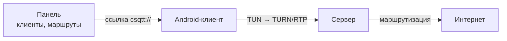

<div align="center">

# reCSQTT

TURN/RTP-туннель, замаскированный под медиатрафик звонка.


</div>

reCSQTT — Android-клиент и Linux-сервер. Клиент поднимает на телефоне локальный
TUN-интерфейс и гонит трафик через TURN/RTP так, что для сети это выглядит как
медиа звонка. Сервер держит веб-панель с клиентами и маршрутами и выдаёт ссылки
`csqtt://`, по которым приложение подключается.

Приложение — только участник: сервер оно не разворачивает и настраивается одной
ссылкой из панели.

**Другие клиенты с поддержкой CSQTT:** [focsq](https://github.com/luminescq/focsq)
(Windows/Linux), [vk-turn-proxy-ios](https://github.com/anton48/vk-turn-proxy-ios) (iOS).
**Похожий проект:** [turn-proxy-android](https://github.com/hackdiaz-dev/turn-proxy-android).

## Быстрый старт

**Сервер** — Linux x86_64, root:

```bash
sudo bash -c "$(wget -qO- https://github.com/w3struk/recsqtt/releases/latest/download/bootstrap.sh)"
```

Установщик сам ставит зависимости, спрашивает домен и порты, а в конце один раз
печатает URL панели, логин и пароль. Если `wget` нет — тот же скрипт через
`curl -fsSL`. Неинтерактивно (CI, cloud-init) — добавьте `-- --yes`.

**Клиент** — Android 8.0+, APK из [Releases](https://github.com/w3struk/recsqtt/releases/latest):
установите, откройте панель → **«Клиенты»** → **«Создать доступ»**, скопируйте
ссылку `csqtt://` или QR и вставьте её в приложении на вкладке **«Туннель»**.

На сервере дальше работает `csqttctl`:

```bash
sudo csqttctl status        # режим, версия, порты, служба, TUN, сертификат
sudo csqttctl credentials   # URL панели, логин и пароль
sudo csqttctl logs -f       # живой лог службы или контейнера
sudo csqttctl update        # обновить сервер
```

## Как это работает



- **Сервер** — один статический бинарник (musl, amd64) с панелью на HTTPS, TUN и
  маршрутизацией по спискам RU-доменов и CIDR. Ставится `scripts/install.sh`,
  вход — `bootstrap.sh` из релиза.
- **Клиент** — приложение принимает `csqtt://` (хост, порт, пароль) и маскирует
  трафик под звонок. Ручных профилей с хостом и паролем в нём нет.

## Установка и обслуживание

Интерактивные шаги, флаги установщика, обновление, откат и диагностика —
в [INSTALL.md](INSTALL.md). Docker-режим — в [docker/README.md](docker/README.md).

## Сборка

```bash
bash rust-server/build_linux.sh --no-tests   # сервер (musl, amd64)
bash rust-client/build_so.sh --no-tests      # клиент (3 ABI)
bash scripts/build_apk.sh                    # release-APK в app/release/
```

В APK едет только клиент. Серверный бинарник, `install.sh` и `bootstrap.sh`
публикуются отдельными ассетами релиза. Подробности, флаги и provenance —
в [BUILDING.md](BUILDING.md).

## Структура

```
app/          Android-клиент (Kotlin/Compose)
rust-client/  клиент на Rust, дочерний процесс в APK
rust-server/  сервер: панель, TUN, маршрутизация
shared/       общий код обоих крейтов
docker/       образ и compose
scripts/      установщик, bootstrap, сборка APK
```

## Документация

| Документ | О чём |
| --- | --- |
| [BUILDING.md](BUILDING.md) | сборка, CI, provenance, подпись релиза |
| [ARCHITECTURE.md](ARCHITECTURE.md) | транспорт, маршрутизация, панель, wire-протокол |
| [INSTALL.md](INSTALL.md) | установка, флаги, обновление и откат, диагностика |
| [DESIGN.md](DESIGN.md) | визуальный язык Android-клиента |
| [docker/README.md](docker/README.md) | контейнерный образ и compose |
| [AGENTS.md](AGENTS.md) | правила для ИИ-агентов, работающих с репозиторием |

## Лицензия

[PolyForm Noncommercial 1.0.0](LICENSE): проект можно использовать и изменять в
некоммерческих целях.
